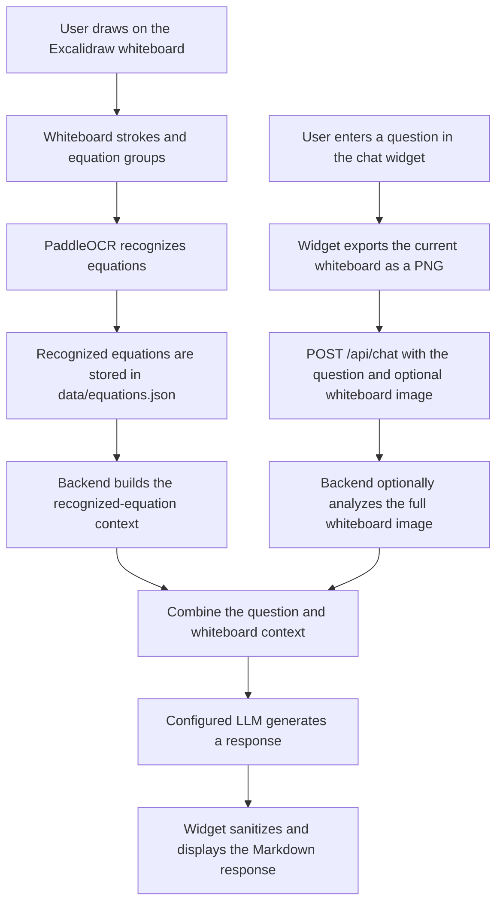

# Excalidraw Chatbot

This project provides an AI chatbot for an Excalidraw whiteboard. The chatbot can inspect the current board, recognize mathematical equations with PaddleOCR, and use the recognized whiteboard context to answer questions through the Claude API.

## Project components

- `widget/` contains the browser-based chat widget and its Excalidraw integration.
- `backend/` contains the FastAPI application, OCR services, chatbot service, and whiteboard reasoning pipeline.
- `data/strokes.json` stores the current whiteboard stroke snapshot.
- `data/equations.json` stores grouped and recognized equations.

## Chatbot workflow



The main chat flow works as follows:

1. The widget initializes inside the host page and connects to the Excalidraw bridge.
2. The user types a question and submits it by pressing Enter or clicking the send button.
3. The widget asks the bridge to export the current whiteboard as a PNG.
4. The widget sends the question and, when available, the PNG to `POST /api/chat` as form data.
5. The backend analyzes the supplied whiteboard image with PaddleOCR.
6. The backend also loads previously recognized equations from `data/equations.json`, ordered by their position on the board.
7. The full-board analysis and recognized equations are combined into the chatbot context.
8. The question and context are sent to the configured LLM provider.
9. The API returns the answer to the widget, which sanitizes and renders it as Markdown.

### Equation-processing workflow

The backend also exposes a more focused equation pipeline:

1. `POST /api/strokes/sync` replaces the stored stroke snapshot with the current whiteboard state and removes equations whose strokes no longer exist.
2. `POST /api/equations/group` groups nearby freehand strokes into candidate equation regions.
3. `POST /api/equations/{equation_id}/ocr` recognizes an individual equation image with PaddleOCR and saves the result.
4. `POST /api/equations/sync` can save recognized equation groups in a batch.
5. `GET /api/whiteboard/hints` reads the recognized equations, identifies relationships and equation frontiers, and returns suggested next-step tutoring hints.

These endpoints are available for the surrounding Excalidraw integration; the chat widget shown in this repository directly calls `POST /api/chat`.

## Run the backend

### Install the required packages

From the project root, create and activate a Python virtual environment:

```bash
python -m venv .venv
source .venv/bin/activate
```

On Windows, activate the environment with:

```powershell
.venv\Scripts\activate
```

Install all backend packages from the canonical dependency file:

```bash
python -m pip install -r backend/requirements.txt
```

`requirement.doc` remains a pip-compatible entry point that includes
`backend/requirements.txt`, so the previous installation command still works.

### Configure and start the server

The backend reads its settings from `backend/.env`. Use `backend/.env.example`
as a template if that file does not already exist. Store real keys only in your
local `.env` file:

```dotenv
OPENAI_API_KEY=
ANTHROPIC_API_KEY=
# CLAUDE_API_KEY=  # Alternative name for ANTHROPIC_API_KEY
OPENAI_MODEL=gpt-4.1
CLAUDE_MODEL=claude-sonnet-4-6
LLM_PROVIDER=openai
```

Set either key to use that provider. With both keys set, `LLM_PROVIDER` selects
the first provider (`openai` by default; `claude` or `anthropic` selects Claude).
If its call raises an exception, the backend logs a warning and tries the other
provider once. With neither key set, LLM calls raise a clear configuration error.
Provider SDKs are imported only when needed.

All four chat operations use `app/services/llm_service.py`, with shared prompts
and output formats. `OPENAI_MODEL` defaults to the vision-capable `gpt-4.1`;
choose another vision-capable model if overriding it, because the same model
handles text and image calls. `CLAUDE_MODEL` defaults to `claude-sonnet-4-6`.
Requests include provider and operation fields in `backend/logs/openai_requests.jsonl`
or `backend/logs/claude_requests.jsonl`. Image analyses are cached separately
for each provider and checked against the configured model.

Do not commit API keys. Restart the backend after configuration changes.
For command-line checks without starting the server, see
[the LLM testing guide](docs/LLM_TESTING.md).

From the project root, enter the backend directory and start the FastAPI server:

```bash
cd backend
python run.py
```

The server uses `BACKEND_HOST` and `BACKEND_PORT` from `backend/.env`. Once it is running, the root endpoint returns a confirmation message, and the interactive FastAPI documentation is available at `/docs`.

## Main API endpoints

| Method | Endpoint | Purpose |
| --- | --- | --- |
| `GET` | `/` | Check that the backend is running |
| `GET` | `/health` | Check application health |
| `POST` | `/api/chat` | Ask a question using the current whiteboard context |
| `POST` | `/api/analyze` | Analyze a complete whiteboard image |
| `POST` | `/api/analyze-equations` | Recognize multiple cropped equation images |
| `POST` | `/api/strokes/sync` | Store the current whiteboard stroke snapshot |
| `POST` | `/api/equations/group` | Group strokes into candidate equations |
| `POST` | `/api/equations/{equation_id}/ocr` | Recognize and store one equation |
| `GET` | `/api/whiteboard/hints` | Generate next-step tutoring hints |
